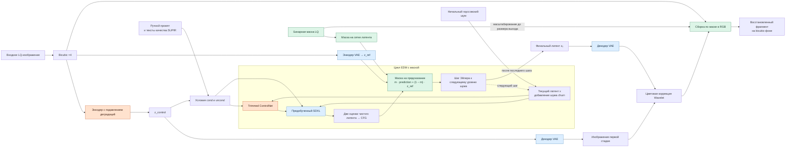
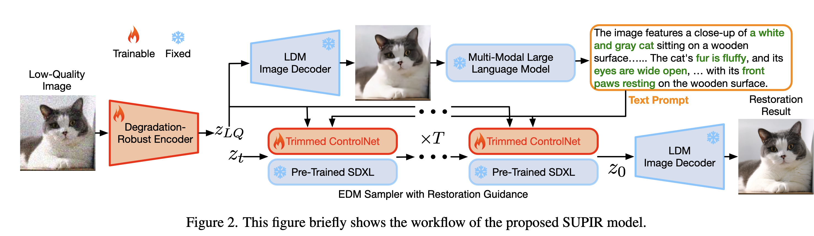

# ЛР3. Восстановление изображения по маске с SUPIR

Цель работы — Разобраться в устройстве диффузионных image-to-image моделей.

## Теория

При обучении диффузионной модели исходный эмбеддинг/изображение $z_0$ зашумляют. В DDPM состояние на шаге $t$ можно получить сразу:

$$
z_t = \sqrt{\bar{\alpha}_t}\,z_0 + \sqrt{1-\bar{\alpha}_t}\,\varepsilon,
\qquad \varepsilon \sim \mathcal N(0,I).
$$
Коэффициент $\bar{\alpha}_t$ убывает с ростом $t$, поэтому доля шума увеличивается. При восстановлении SUPIR начинает со случайного эмбеддинга $x$ и выполняет обратный процесс. ControlNet передаёт SDXL признаки входного снимка на каждом шаге. CFG объединяет оценки с положительным и отрицательным промптами: $D = D_{\mathrm{neg}} + s(D_{\mathrm{pos}}-D_{\mathrm{neg}})$, где $s$ задаёт силу текстового управления.

В упрощённой схеме маска $m$ смешивает оценку чистого латента $D$ с латентом bicubic-входа $z_{\mathrm{ref}}$. Затем шаг Эйлера обновляет состояние с уровня шума $\hat\sigma$ до $\sigma_{\mathrm{next}}$:

$$
D_m=mD+(1-m)z_{\mathrm{ref}},\qquad
x_{\mathrm{next}}=x+(\sigma_{\mathrm{next}}-\hat\sigma)\frac{x-D_m}{\hat\sigma}.
$$

Внутри маски $m=1$, снаружи $m=0$. После декодирования фон копируется из bicubic, чтобы сохранить его пиксель в пиксель.

Источники — [DDPM](https://arxiv.org/abs/2006.11239), [EDM](https://arxiv.org/abs/2206.00364), [SUPIR](https://arxiv.org/abs/2401.13627).

## Результаты

Использованы три изображения и две деградации на каждое — уменьшение bicubic в 4 раза и уменьшение с размытием и конвертацией в JPEG. У **mixed** маска влияет на семплирование и финальную склейку. Для **post_mask** SUPIR восстанавливает все изображение, после чего применяется та же маска.

| Вариант | PSNR ↑, дБ | LPIPS ↓ | CLIP-IQA ↑ |
|---|---:|---:|---:|
| Bicubic | **25,07** | 0,3766 | 0,7802 |
| mixed | 24,38 | 0,3109 | **0,8647** |
| post_mask | 24,04 | **0,3006** | 0,8120 |

## Вывод

Оба способа улучшили LPIPS относительно bicubic во всех шести случаях. По сравнению с post_mask, mixed дал в среднем на **0,35 дБ** больше по PSNR и на **0,053** больше по CLIP-IQA. У post_mask LPIPS ниже на **0,010**
